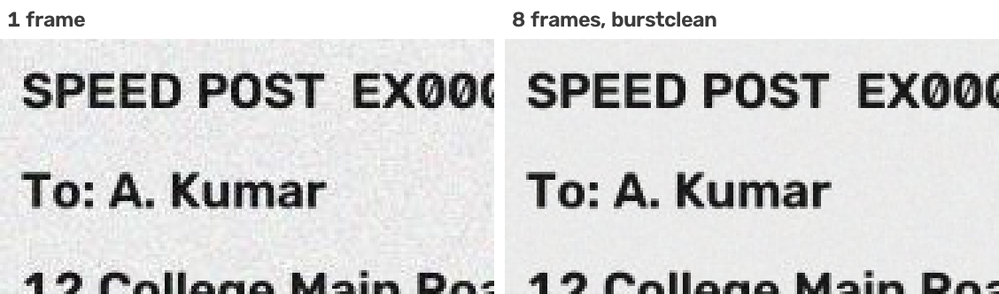

# burstclean

Turn a burst of noisy camera frames into one clean image. burstclean keeps the sharpest frames from about 2 seconds of video, lines them up and averages them. Grain and compression speckle fade, and the print stays sharp.



## Why

Cheap webcams and phone cameras have small sensors. Indoors, every frame comes out grainy and is then compressed to MJPEG. Small print such as tracking numbers, PIN codes and amounts gets hard to read, for people and for OCR or vision models alike. A single snapshot is also a gamble: it may land on a moment of focus hunting or a shaky hand.

A short video gives you many looks at the same scene. Sensor noise is random from frame to frame, but the scene stays the same. Aligning N frames and averaging them cuts the noise by about √N, and the edges stay sharp. Phone cameras do the same thing in their night and HDR modes. burstclean does it with OpenCV, for any camera you can open with `cv2.VideoCapture`.

It was pulled out of a parcel-label scanning desk, where a webcam reads shipping labels, and works for any still subject: documents, receipts, labels, screens, meter readings.

## Install

```bash
pip install git+https://github.com/Snehodeep/image-processing.git
```

It needs Python 3.9 or newer. It installs `numpy` and `opencv-python-headless`.

## Quick start

```python
import cv2
import burstclean as bc

frames = bc.capture_burst(camera=0, seconds=2)   # the 5 sharpest frames, sharpest first
result = bc.enhance(frames)                      # finds the document, aligns, averages

cv2.imwrite("clean.png", result.image)           # merged, at full camera resolution
cv2.imwrite("single.png", result.reference)      # same region from the sharpest single frame
print(f"merged {result.used} of {result.total} frames, region {result.box}")
```

You can use other frame sources:

```python
frames = bc.burst_from_video("clip.mp4", start=3.0, seconds=2)   # a still stretch of a video
frames = bc.burst_from_files(["a.jpg", "b.jpg", "c.jpg"])          # several photos of the same scene

best = bc.BestFrames(keep=5)          # your own capture loop: only the 5 sharpest are kept in memory
for frame in my_frames():
    best.add(frame)
result = bc.enhance(best.frames)
```

From the command line:

```bash
burstclean camera -o clean.png --reference single.png      # 2 s from camera 0
burstclean video clip.mp4 --start 3 --seconds 2 -o clean.png
burstclean files a.jpg b.jpg c.jpg -o clean.png --region full
```

The command prints how many frames were merged and why any were left out. In this run, one of five photos was taken after the label had moved 60 px:

```
$ burstclean files shot*.png -o clean.png
merged 4 of 5 frames · 689x505 at (730, 410) · document found -> clean.png
  sharpest #2 left out: moved (shift +60.6, +2.0 px, response 0.98)
```

## How it works

1. **Capture a burst.** Record about 2 s of video at the camera's highest resolution. The first second is dropped while auto exposure and focus settle.
2. **Keep the sharpest frames.** Each frame is scored by the variance of the Laplacian on a half-size grey copy. Sharp, still frames score high; motion blur and focus hunting score low. Only the top 5 are kept, so 2 s of 4K (about 1.5 GB) is never held in memory.
3. **Choose the region.** By default (`region="auto"`), burstclean looks in the sharpest frame for a printed document: a bright, low-saturation paper area holding line-shaped dark text. Only that box is merged, cut at full camera resolution. When no document is found, the whole frame is used. You can also pass `"full"` or your own `(x, y, w, h)`.
4. **Align and average.** Each other frame's region is aligned to the sharpest one by phase correlation, which measures the shift to about a quarter of a pixel. The frame is moved back with cubic interpolation, then everything is averaged. A frame is left out when:
    - its correlation peak is below 0.2, meaning the content is different (a hand in view), or
    - it moved more than 2% of the region, meaning the object was still being placed.

## Results

[`examples/benchmark.py`](examples/benchmark.py) simulates a cheap webcam looking at a shipping label:

- 960×540 camera
- sensor noise σ = 10 grey levels
- MJPEG quality 75
- 5 trials

It measures each result against the noise-free view as PSNR, in dB; higher is better. A single frame scores **30.8 dB**.

| Frames | burstclean, fixed camera | burstclean, shake ≤ 0.5 px | burstclean, shake ≤ 2 px | Plain average, shake ≤ 2 px |
| --- | --- | --- | --- | --- |
| 1 | 30.8 | 30.8 | 30.8 | 30.8 |
| 2 | 33.1 | 31.7 | 32.4 | 22.9 |
| 3 | 34.1 | 31.8 | 33.4 | 21.0 |
| 5 | 35.2 | 31.7 | 33.5 | 19.5 |
| 8 | 36.0 | 31.9 | 33.6 | 20.3 |

- **A fixed camera gains the most:** +4.4 dB with 5 frames and +5.2 dB with 8. At +4.4 dB, the squared error falls to about a third of a single frame's. A camera on a stand over a desk or counter is the case this was built for.
- **When the frames shake**, each one has to be moved by a fraction of a pixel, and that interpolation softens it a little. The gain is smaller (+0.9 to +2.8 dB) but still positive.
- **Alignment is what makes averaging work.** Averaging the same shaky frames without it smears the print and loses 8 to 11 dB.

Run it yourself with `python examples/benchmark.py`. Add `--save docs` to write the before/after picture.

## API

| Name | What it does |
| --- | --- |
| `capture_burst(camera=0, seconds=2.0, keep=5, *, resolution=(3840, 2160), warmup=1.0)` | Records from a camera index or stream URL; returns the `keep` sharpest frames, sharpest first |
| `burst_from_video(path, keep=5, *, start=0.0, seconds=None)` | Same, from a video file |
| `burst_from_files(paths, keep=5)` | Same, from still images |
| `BestFrames(keep=5)` | `.add(frame)` scores and keeps the sharpest; `.frames`, `.scores`, `.seen` |
| `enhance(frames, region="auto", *, sort=True, max_shift=0.02, min_response=0.2)` | The full pipeline. Returns `EnhanceResult` with `image`, `reference`, `box`, `used`, `total`, `document_found`, `shifts` |
| `merge(frames, box=None, *, max_shift=0.02, min_response=0.2)` | Aligns and averages one region against `frames[0]`. Returns `MergeResult` with `image`, `used`, `box`, `shifts` |
| `find_document(img, *, pad=0.03)` | `(x, y, w, h)` of the printed paper region in a BGR frame, or `None` |
| `sharpness(img)` | Laplacian-variance focus score |

`shifts` holds one `FrameShift(dx, dy, response, used, reason)` per frame after the reference, so you can see what was dropped and why. Any image dtype works: `merge` keeps uint8, uint16 or float, grey or colour.

## Tuning

| Setting | Default | When to change it |
| --- | --- | --- |
| `keep` | 5 | Raise it for a fixed camera in dim light: more frames, less noise. Lower it if memory or time is tight. |
| `seconds` | 2.0 | Raise it if the camera delivers few frames per second. Lower it if the subject is not held still that long. |
| `max_shift` | 0.02 | Raise it for a handheld camera whose frames are dropped as "moved". Lower it if you see doubled edges. |
| `min_response` | 0.2 | Raise it if frames with something else in view are getting merged. Lower it if good frames are dropped as "low_response". |
| `resolution` | 3840×2160 | Pass `None` to keep the camera's default mode if its top mode is slow. Cameras without 4K fall back to a mode they have. |

## Limits

- **Translation only.** Rotation, zoom and perspective change between frames are not modelled. They are small for a camera on a stand. Frames where they are large fail the shift or response check and are left out.
- **The subject must be still** for the burst. Moving parts inside the region blur.
- **It needs some detail to align on.** In a nearly featureless region (a blank wall) under heavy noise, the correlation peak is weak. Frames are then left out as `low_response`, so less noise is removed, but the result is never worse than the single sharpest frame. Printed text gives plenty to align on.
- **The document finder is a heuristic.** It looks for light paper with dark print against a darker or coloured background. On other scenes, pass the region yourself or use `"full"`.
- **Speed.** On 4K frames with 5 kept frames, merging a label-sized region takes about 0.2 s, and the whole frame about 1 s (Apple M1). Scoring sharpness takes about 8 ms per frame.
- **No sharpening or contrast changes.** The output is the camera's own image with the noise averaged out, which is usually what OCR and vision models read best.

A note for anyone using `cv2.phaseCorrelate` directly: it pads the input to an "optimal" FFT size, and when that size is odd (for example 372 → 375), it reports a 0.5 px shift between two identical images. burstclean measures shifts on a centred window whose size needs no padding, so this does not happen.

## Development

```bash
git clone https://github.com/Snehodeep/image-processing.git
cd image-processing
python -m venv .venv && . .venv/bin/activate
pip install -e ".[dev]"
pytest
```

## License

MIT. See [LICENSE](LICENSE).
